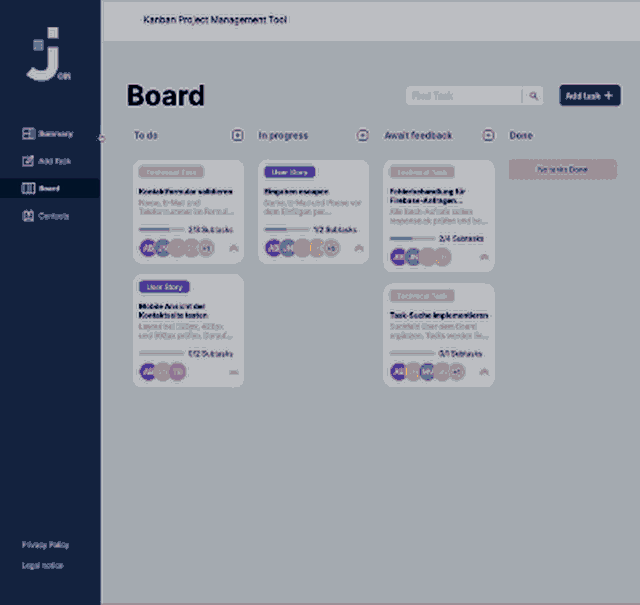
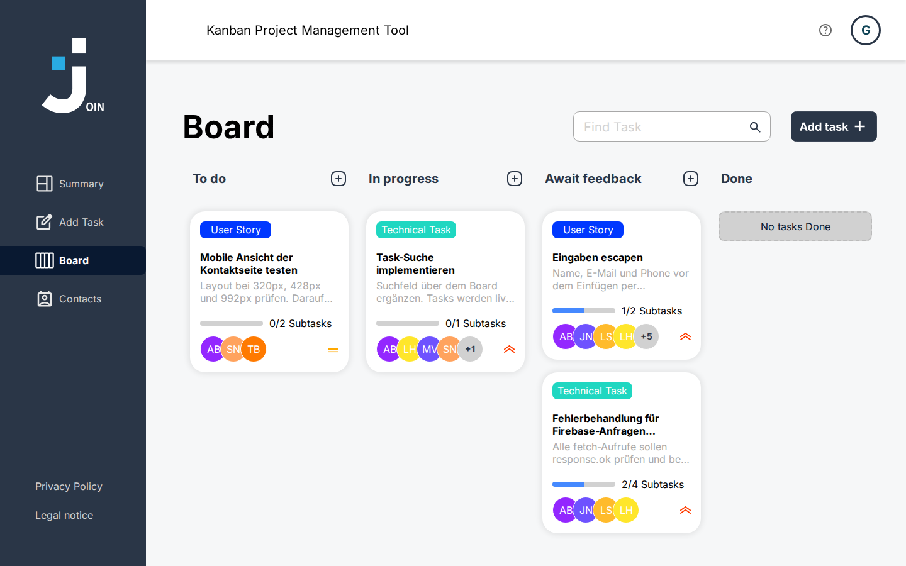
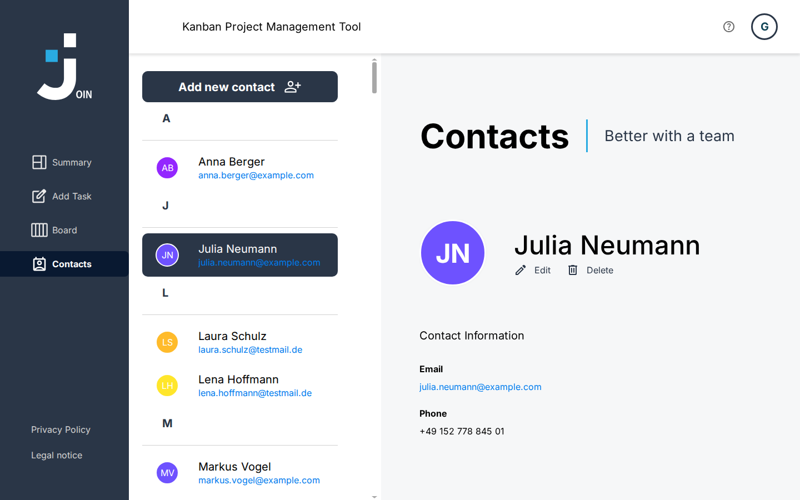

# Join 360 – Kanban Project Management Tool

**▶ [Live Demo](https://oeztuerk1992.github.io/Join-Project/)** – no sign-up needed: just click **"Guest Log in"**.

Join is a Kanban-based project management tool, built as a student group project at the Developer Akademie with **HTML, CSS and Vanilla JavaScript** (no frameworks). Data is stored in **Firebase Realtime Database**.



### Screenshots





---

## Features

- Login and registration, including guest login
- Summary page with key figures
- Kanban board with four columns: drag & drop, search and editing of tasks
- Create tasks with title, description, due date, priority, category, assigned contacts and subtasks
- Contact management
- Help, legal notice and privacy policy pages
- Responsive layout from 320 px width

## Tech Stack

- HTML5
- CSS3
- JavaScript (Vanilla, ES6)
- Firebase Realtime Database
- Git & GitHub (team workflow)
- Figma (design)

## Getting Started

1. Clone the repository:
   ```bash
   git clone https://github.com/Oeztuerk1992/Join-Project.git
   ```
2. Open the project folder in VS Code and start it with **Live Server**.
3. Open `index.html`.

## Project Structure

```
index.html            Login page
html/                 Other pages
scripts/              JavaScript, organized by page
scripts/templates/    HTML templates as functions
styles/               CSS
assets/               Images, icons, fonts
```

## My Contribution (Sinan Öztürk)

- **Contacts page** built from the Figma design: alphabetically grouped contact list, animated detail panel, overlays with form validation, responsive down to 320 px
- **Sidebar and header**: navigation, help icon and user menu, used across all pages
- **Final review after mentor feedback**: responsive fixes, touch drag & drop on tablets, redirect for visitors who are not logged in
- **Clean code rules**: max. 14 lines per function, max. 400 lines per file, JSDoc comments
- **Git teamwork**: resolved merge conflicts in a team of three

## What I Learned

- **Teamwork with Git:** coordinating work in a team of three and resolving merge conflicts
- **Turning a design into code:** implementing a Figma design precisely with HTML and CSS
- **Responsive design:** making the app work from 320 px up to desktop, including touch input on tablets
- **Working with feedback:** improving my code step by step after mentor reviews

## Team

| Name | GitHub |
|---|---|
| Sinan Öztürk | [@Oeztuerk1992](https://github.com/Oeztuerk1992) |
| Rico Elmerich | [@ricoelmerich](https://github.com/ricoelmerich) |
| Mehmet Sefa Gürcan | [@Yavuba](https://github.com/Yavuba) |

## Design

Designed in Figma. Font: Inter.
